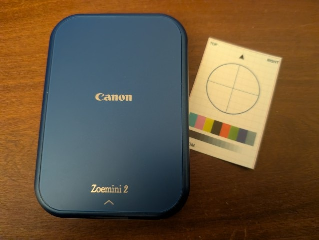

# zoemini

Print on a **Canon Zoemini 2** mini photo printer over Bluetooth from Linux, without the official app, and **emulate** the printer for testing.

The Zoemini 2 is sold as the **Canon Ivy 2** in the United States and as the **Canon iNSPiC PV-223** in Japan; all three are the same device (model PV-223), printing 2 × 3" photos on ZINK paper. The code should therefore work with any of them; it has been tested with a Zoemini 2.

The project contains:

- `zoemini`, a command-line tool and Python package that queries the printer, changes its settings and prints images;
- an **emulator** that makes a Linux computer appear as a Zoemini 2, so that the official Canon Mini Print app (or this package) can "print" to it; every received image is saved as a JPEG;
- [`protocol.md`](protocol.md), a description of the Bluetooth protocol.

This project started from [**ivy2**](https://github.com/dtgreene/ivy2) by dtgreene, a Python library for the Canon Ivy 2. `zoemini` is an independent implementation, written from scratch, that fixes several points of the protocol and of the image format (battery level, image geometry, end-of-print tracking).

Not affiliated with or endorsed by Canon. "Canon", "Zoemini", "Ivy" and "iNSPiC" are trademarks of their owners.

**Requirements**: Linux with BlueZ, a Bluetooth adapter, Python ≥ 3.11 and Pillow. The emulator also needs `dbus-fast`.

Tested, printing and emulator, with the procedure below and no changes:

| Machine | Bluetooth adapter | OS | Architecture | BlueZ | Python |
|---|---|---|---|---|---|
| Raspberry Pi Zero 2 W | built-in | Raspberry Pi OS Lite 64-bit (Debian 13) | aarch64 | 5.82 | 3.13.5 |
| Raspberry Pi 4 | built-in | Raspberry Pi OS Lite 64-bit (Debian 13) | aarch64 | 5.82 | 3.13.5 |
| PC | Intel BE200 (USB `8087:0036`) | Debian GNU/Linux 13 (trixie) | x86_64 | 5.82 | 3.13.5 |

| File | Role |
|---|---|
| `src/zoemini/protocol.py` | frames, reassembly, decoding (no I/O) |
| `src/zoemini/image.py` | image preparation to the printer's format |
| `src/zoemini/transport.py` | RFCOMM socket (standard library) |
| `src/zoemini/printer.py` | session, status, settings, print sequence and progress |
| `src/zoemini/cli.py` | `zoemini` command |
| `src/zoemini/emulator.py` | emulated printer, independent of Bluetooth |
| `src/zoemini/bluez_emulator.py` | publication of the emulator through BlueZ (D-Bus) |
| `protocol.md` | protocol description |

---

## 1. Printing

### 1.1 Installation

```bash
python3 -m venv .venv
. .venv/bin/activate
pip install .
zoemini --help
```

No root access and no group membership are needed to print.

### 1.2 Bluetooth

Make sure the Bluetooth adapter is unblocked and powered (on Raspberry Pi OS Lite it is blocked by default):

```bash
sudo rfkill unblock bluetooth
bluetoothctl power on
```

Switch the printer on, **close the Canon app** on any phone (the printer accepts one connection at a time), then find and pair the printer once:

```bash
bluetoothctl --timeout 15 scan on | grep -i "mini printer"     # Canon (XX:XX) Mini Printer
bluetoothctl --agent NoInputNoOutput pair <address>
bluetoothctl trust <address>
```

Pairing is *Just Works*: there is no PIN to enter.

### 1.3 Usage

The printer's address is given with `-a/--address` or the `ZOEMINI_ADDRESS` variable:

```bash
export ZOEMINI_ADDRESS=<address>

zoemini status                       # model, firmware, battery, paper, state
zoemini test-pattern                 # print a test pattern
zoemini print photo.jpg              # fill the 2×3 print (centred crop)
zoemini print photo.jpg --fit        # whole image, with white bands
zoemini set --auto-off 5             # auto power-off delay: 3, 5 or 10 min
```

Example of `zoemini status`:

```
Model         PV223 (product code 0x21)
Serial no.    …
MAC           …
Firmware      1.4.13    TMD 0.0.24
Photos        16
Auto off      10 min
Battery       100 %
State         READY, error NO_ERROR
Flags         none
Ready         yes
```

Options of `print` and `test-pattern`:

| Option | Effect |
|---|---|
| `--fit` | (`print` only) keep the whole image, add white bands instead of cropping |
| `--no-rotate` | (`print` only) do not rotate landscape images (rotated to portrait by default) |
| `--raw` | no tone curve and no sharpening |
| `--dry-run` | prepare the image without printing |
| `--save-jpeg FILE` | save the JPEG sent to the printer |
| `--preview FILE.png` | save an upright preview at the print's proportions |

General options: `-v/--verbose` shows the exchanged frames; `--channel` sets the RFCOMM channel (1 by default).

```bash
zoemini print photo.jpg --dry-run --preview preview.png    # check the framing without printing
```


*Test pattern printed with `zoemini test-pattern`.*


### 1.4 Behaviour

- Before printing, `zoemini` checks the printer's state and refuses to print if the cover is open, the paper is missing or wrong, or the printer is busy. If the blue calibration sheet is being fed (new paper pack), it waits for the end of the calibration.
- Progress is displayed during the transfer (about 10 s) and the print (about 50 s).
- About 20 s after a print, the printer closes the Bluetooth link: this is normal. Each `zoemini` command opens its own connection.
- By default, images get a mild tone curve (shadows lifted according to the image's brightness) and sharpening, to compensate for the ZINK paper. `--raw` disables it.
- Exit codes: `0` success, `1` printing refused or failed, `2` connection error.

### 1.5 Python API

```python
from PIL import Image
from zoemini import image
from zoemini.printer import Printer

jpeg = image.prepare(Image.open("photo.jpg"))          # mode="fit", enhanced=False, …
with Printer("<address>") as p:
    print(p.status().power.battery, "%")
    p.print_jpeg(jpeg, progress=lambda stage, pct: print(stage, pct))
```

---

## 2. Emulator

The emulator makes the Linux computer present itself as a Zoemini 2: same Bluetooth name format, same services, same responses. The Canon Mini Print app can add it, connect to it and print to it; each image it sends is saved as a JPEG, exactly as the printer would receive it. It can also be used to test `zoemini` itself without paper.

The emulator does not print anything and refuses firmware update commands.

### 2.1 Installation

```bash
python3 -m venv .venv
. .venv/bin/activate
pip install '.[emulator]'          # adds dbus-fast
```

### 2.2 BlueZ configuration

The app pairs twice and needs pairing settings that are weaker than BlueZ's defaults. In `/etc/bluetooth/main.conf`, section `[General]`:

```ini
JustWorksRepairing = always
Class = 0x000680
```

- `JustWorksRepairing = always` is required: otherwise BlueZ refuses the app's second pairing.
- `Class = 0x000680` (imaging / printer) is optional.

**Secure Connections** must also be off, otherwise the phone gives up pairing. With BlueZ 5.82, the `SecureConnections = off` key of `main.conf` is not enough; use `btmgmt` after the service has restarted:

```bash
sudo systemctl restart bluetooth
sudo btmgmt sc off
btmgmt info | grep "current settings"       # must not contain secure-conn
```

`btmgmt sc off` is lost at every restart of the Bluetooth service or of the computer.

### 2.3 Running

1. **Switch the real printer off.**
2. Start the emulator:
   ```bash
   zoemini emulate --out received
   ```
   ```
   Emulator running: "Canon (XX:XX) Mini Printer" (…), discoverable 300 s, serial EMFEMUL00001.
   ```
3. On the phone, within the discoverable period: open the Mini Print app, add the printer `Canon (XX:XX) Mini Printer` (the last two bytes of the computer's Bluetooth address), accept the pairing request, and print a photo.
4. The received images are written to `received/app_<date>_<time>.jpg`.
5. Stop with **Ctrl+C**: the adapter's original name is restored.

Options:

| Option | Effect |
|---|---|
| `--out DIR` | folder for the received JPEGs (`captures/emulator` by default) |
| `--visible SECONDS` | discoverable duration (300 by default) |
| `--adapter NAME` | Bluetooth adapter (`hci0` by default) |
| `--color A…F` | announced body colour, shown as the printer's icon in the app: A black/pink/rose gold, B pearl white, C blue, D rose gold/white, E pearl white/silver, F navy/white (default) |
| `--serial TEXT` | full serial number (13 characters at most; overrides `--color`) |
| `-v` | show every exchanged frame |

The received JPEGs are 640 × 1608 pixels, rotated by 180° and with non-square pixels (see `protocol.md` §5). An upright preview can be obtained with `zoemini.image.preview(jpeg_bytes)`.

### 2.4 After use

While it runs, the emulator makes the computer discoverable and **accepts any pairing**, with weakened security settings. Use it only for the duration of the tests, then restore the normal configuration:

```bash
# remove JustWorksRepairing = always (and Class) from /etc/bluetooth/main.conf, then:
sudo systemctl restart bluetooth
sudo btmgmt sc on
```

### 2.5 Troubleshooting

| Symptom | Remedy |
|---|---|
| The phone gives up pairing | Secure Connections still on: `sudo btmgmt sc off` |
| BlueZ refuses the second pairing | `JustWorksRepairing = always` missing from `main.conf` |
| The app no longer finds the emulator, while Android lists it | restart the phone |
| An old `Canon (XX:XX) Mini Printer` entry on the phone | remove it in Android's Bluetooth settings and pair again |
| The emulator was stopped abruptly and the computer keeps the Canon name | `bluetoothctl system-alias "$(hostname)"` |

---

## Protocol

See [`protocol.md`](protocol.md): transport, frame format, commands, print sequence, image format, error codes, and remaining open questions.

## License

MIT, see `LICENSE`.
